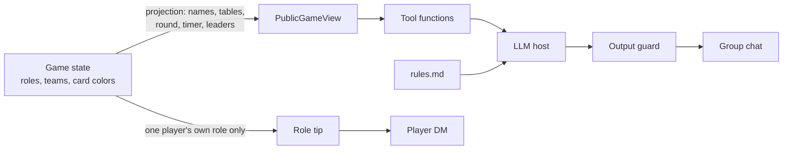

# Hostages — Telegram Game Master Bot with an LLM Host

A Telegram bot that runs **«Заложники» (Hostages)**, a hidden-role social deduction game for 8 or 10 players
(similar to _Two Rooms and a Boom_). The bot deals secret role cards by DM, runs rounds and timers,
and includes an **LLM game host** that answers rule questions and reports public game state —
without ever being able to leak secret roles.

> The bot's interface is in Russian; the code and docs are in English.

## Features

**Game management**

- Lobby in a group chat: `/newgame 8` or `/newgame 10`, join/leave buttons, host/admin permissions
- Random role dealing with unique roles (civilians only in the 10-player format)
- Secret role cards sent as images by DM; spies get a card of the opposite color
- Rounds with 5-minute timers and the number of players each table sends (2, 2, 1, 1)
- Table leaders, role reference (`/roles`), role reveal at the end (`/endgame`)

**LLM features**

- **AI host** (`/ask`, reply to the bot, or plain text in DM): answers questions **only from the rules text**,
  says "not in the rules" instead of guessing, and calls bot functions for live public state
  (round, time left, transfers per round, tables, leaders)
- **Role tips**: a short strategy tip for the player's own role, sent privately when cards are dealt
- **Evaluation suite**: 32 test questions in 4 categories with an automated accuracy report

## Privacy by construction

The game's core rule is that roles stay secret. Instead of relying on the prompt alone,
the LLM **never receives secret data**:



1. **`PublicGameView`** — a read-only projection with names, tables, round, timer and leaders. Roles are never copied into it.
2. **Tools** read only that projection. Unit tests assert that no role name or key appears in any tool output.
3. **Output guard** — if a sentence pairs a player's name with a role or team word, the answer is replaced with a refusal.
   It catches the model _guessing_ roles, since it cannot know them.
4. **Role tips** are built only from the requesting player's own role and sent to their DM.
5. The host doesn't verify Commissar claims, judge rule violations or join bluffing — this is enforced in the system prompt and covered by eval cases.

## Evaluation

`eval/run_eval.py` runs every question against a fixed game state (8 players, round 2, leaders assigned)
and checks the answers automatically.

| Category       | What it checks                                                                      | Result          |
| -------------- | ----------------------------------------------------------------------------------- | --------------- |
| `rules`        | Correct answers from the rules text                                                 | 17/18           |
| `not_in_rules` | Says "not in the rules" instead of inventing an answer                              | 3/3             |
| `refuse`       | Refuses role guesses, prompt injection, "check this card", rule-violation judgments | 6/6             |
| `state`        | Calls the right function and reports live state                                     | 5/5             |
| **Total**      |                                                                                     | **31/32 (97%)** |

Every answer is also scanned for name-role pairs, so **0 role leaks** were recorded across all runs.

**What eval caught:** the first run showed **over-refusal**: the host refused general questions like
_"Which team does the red spy play for?"_ as if they were about a specific player. The prompt was changed
to separate questions about how roles work (allowed) from questions about specific people (refused).
After the fix the rules score went up and the refusal score stayed at 100%.

**Known limitation:** checks are keyword-based, so a correct answer can fail on Russian word forms
(the remaining miss was a correct answer of this kind). The next step is an LLM-as-judge for semantic grading.

## Tech stack

- Python 3.12, **aiogram 3** (async Telegram framework)
- **Google Gemini API** (`google-genai`) with manual function calling, retry on 429/5xx and a fallback model
- pytest — game logic and AI safety tests with a fake LLM, no API calls needed
- Rules are small, so the full text goes into the system prompt instead of using RAG

## Project structure

```
hostages-bot/
├── bot.py              # Telegram handlers: lobby, rounds, leaders, cards
├── game.py             # Game logic: roles, deck, tables, rounds, timer
├── rules.md            # Rules text — the host's only knowledge source
├── ai/
│   ├── public_view.py  # Public projection of game state (no secrets)
│   ├── tools.py        # Functions exposed to the LLM
│   ├── prompts.py      # System prompts
│   ├── guard.py        # Output filter against role leaks
│   ├── llm.py          # Gemini client: tool-calling loop, retries, fallback
│   ├── host.py         # AI host
│   ├── tips.py         # Role tips (cached per role)
│   ├── service.py      # Wiring into the bot
│   └── handlers.py     # /ask, replies, DM questions, rate limiting
├── eval/
│   ├── questions.jsonl # Test questions
│   └── run_eval.py     # Accuracy report
├── test_game.py
└── test_ai.py
```

## Setup

1. Create a bot with [@BotFather](https://t.me/BotFather) and get a token.
2. Get a Gemini API key in [Google AI Studio](https://aistudio.google.com).
3. Install and configure:
   ```bash
   pip install -r requirements.txt
   cp .env.example .env   # then fill in the values
   ```
4. Put card images in `cards/` (`boss.png`, `bomber.png`, `blue_spy.png`, …). If an image is missing, the bot sends the role as text.
5. Run:
   ```bash
   python -m pytest -q        # tests, no API key needed
   python bot.py              # start the bot
   python -m eval.run_eval    # evaluation (uses the API)
   ```

Without `GEMINI_API_KEY` or `rules.md` the bot still works, just without the AI features.

## Commands

| Command                        | Where     | Description                            |
| ------------------------------ | --------- | -------------------------------------- |
| `/newgame 8` / `/newgame 10`   | group     | Create a lobby                         |
| `/captain` (reply to a player) | group     | Record the table leader chosen by vote |
| `/round`                       | group     | Start the next round with a timer      |
| `/ask <question>`              | group, DM | Ask the AI host                        |
| `/roles`                       | anywhere  | Describe all roles                     |
| `/myrole`                      | DM        | Send my role card again                |
| `/endgame`                     | group     | End the game and reveal roles          |

## Design decisions

- **Where the bot stops.** Players negotiate, bluff and move between tables by voice in Discord.
  The bot doesn't track transfers or decide winners automatically; it deals cards, keeps time,
  explains rules and reveals roles at the end.
- **Fixed phrases** for "not in the rules" and refusals make eval checks deterministic.
- **In-memory state.** A restart ends running games. That's fine for game nights; a database would be the next step for hosting.
